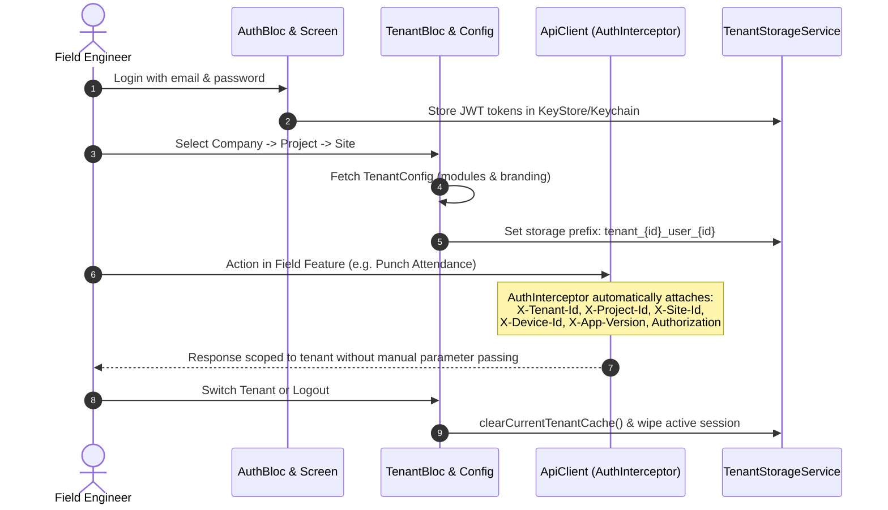

# Sarjan Construction Platform (Mobile, Web & Backend Parallel Foundation)

A scalable, feature-first, multi-tenant SaaS Flutter foundation designed for construction and infrastructure enterprises. One unified app serves all client tenants, with tenant context (`company`, `project`, `site`, and `branding`) resolved dynamically at runtime after authentication.

---

## 🏗️ Architectural Highlights

- **Multi-Tenant SaaS Foundation**: Tenant context is resolved dynamically post-login—**never hardcoded at build time**.
- **Zero Tenant-Specific Code Branches**: Features and branding are driven entirely by dynamic tenant configurations.
- **Dynamic Multi-Color Theme with BLoC**: Switch between curated enterprise palettes (Amber, Cobalt, Emerald, Steel Crimson, Violet) or adopt tenant brand colors on the fly in both Light and Dark modes.
- **Automated HTTP Headers**: The network client automatically injects `X-Tenant-Id`, `X-Project-Id`, `X-Site-Id`, `X-Device-Id`, and `X-App-Version` on every request.
- **Tenant-Isolated Local Storage & Cache**: Scoped storage keys (`tenant_{tenantId}_user_{userId}_{key}`) prevent data bleed across tenants and users on shared devices.
- **Cryptographic Token Security**: Access and refresh tokens are secured in the Android KeyStore and iOS Keychain via `flutter_secure_storage`.
- **Declarative Navigation & Route Guards**: Protected by `AuthGuard`, `TenantGuard`, and `ModuleGuard` placeholders using `go_router`.
- **Flavors Configured**: `dev`, `staging`, and `prod` with distinct bundle IDs, app names, and API base URLs.

---

## 📁 Feature-First Directory Structure

```text
sarjan_construction/
├── android/app/build.gradle.kts    # Flavor dimensions (dev, staging, prod)
├── docs/
│   └── adr/                        # Architecture Decision Records
│       ├── 0001-multi-tenant-architecture-and-state-management.md
│       └── 0002-feature-first-and-dynamic-multi-theme.md
├── lib/
│   ├── app.dart                    # Root MultiBlocProvider and MaterialApp.router
│   ├── bootstrap.dart              # Dependency orchestration & initialization
│   ├── main.dart                   # Default entrypoint (delegates to Dev)
│   ├── main_dev.dart               # Dev flavor entrypoint
│   ├── main_staging.dart           # Staging flavor entrypoint
│   ├── main_prod.dart              # Prod flavor entrypoint
│   │
│   ├── core/                       # Core shared infrastructure
│   │   ├── config/                 # Flavors, AppConfig, AppConstants
│   │   ├── errors/                 # Failures and Exceptions
│   │   ├── network/                # ApiClient (lightweight http with auto-headers)
│   │   ├── router/                 # GoRouter & RouteGuards
│   │   ├── services/               # DeviceInfoService, PackageInfoService
│   │   ├── storage/                # SecureStorageService, TenantStorageService
│   │   ├── theme/                  # Multi-Color Theme Engine & ThemeBloc
│   │   │   └── bloc/               # ThemeBloc, ThemeEvent, ThemeState
│   │   └── utils/                  # AppBlocObserver, SizeUtil (dynamic width, height, padding)
│   │
│   └── features/                   # Clean feature-first architecture (Domain, Data, Presentation)
│       ├── home/                   # Initial entry screen ("Imaker Cunstuction")
│       ├── auth/                   # Clean Auth structure (models, repository, bloc)
│       ├── tenant/                 # Multi-tenant hierarchy & config structure
│       ├── attendance/             # Attendance feature structure
│       ├── qr/                     # Field QR scanner feature structure
│       ├── sos/                    # Emergency hazard broadcast feature structure
│       └── requests/               # Field material requisitions feature structure
```

---

## 🎨 Multi-Color Theme Engine with BLoC

The app features dynamic multi-color themes governed by `ThemeBloc`:
1. **Sarjan Amber (Industrial Gold)** (`#D97706`): Tailored for heavy construction & machinery.
2. **Enterprise Navy (Deep Navy)** (`#1E40AF`): Tailored for corporate infrastructure joint ventures.
3. **Safety Emerald (Eco Green)** (`#059669`): Tailored for solar, environmental, and green townships.
4. **Steel Crimson (Safety Alert)** (`#DC2626`): High-visibility emergency and hazard operations.
5. **Tech Purple** (`#7C3AED`): Modern urban rail & technology projects.
6. **Dynamic Tenant White-Labeling**: When a tenant session is confirmed, the app automatically adopts the tenant's brand colors from the backend configuration.

Tap the **Palette icon** in the top navigation bar at any time to open the **Multi-Color Theme Selector**.

---

## 📏 Dynamic Sizing & Padding Utility (`SizeUtil`)

Available across all screens via static methods or `BuildContext` extension:

```dart
import 'package:sarjan_construction/core/utils/size_util.dart';

// 1. Dynamic Width & Height
final width50 = context.w(50); // 50% of screen width
final height20 = context.h(20); // 20% of screen height

// 2. Dynamic Padding
final allPadding = context.pAll(4); // 4% uniform padding
final symmPadding = context.pSymmetric(hPercent: 5, vPercent: 2); // 5% horizontal, 2% vertical
final onlyPadding = context.pOnly(left: 4, top: 2);

// 3. Screen Dimensions & Responsive Breakpoints
final isMobile = context.isMobile;
final isTablet = context.isTablet;
final isDesktop = context.isDesktop;
```

---

## 🚀 Running the App on Android

### Prerequisites
- Flutter SDK (>= 3.35.0)
- Android Studio / Android SDK with Java 11+
- Android Emulator or physical device connected

### 1. Run with Flavors

#### Development Flavor
```bash
flutter run --flavor dev -t lib/main_dev.dart
```

#### Staging Flavor
```bash
flutter run --flavor staging -t lib/main_staging.dart
```

#### Production Flavor
```bash
flutter run --flavor prod -t lib/main_prod.dart
```

### 2. Default Runner (Dev fallback)
```bash
flutter run
```

---

## 🧪 Testing and Static Code Analysis

### Run Linter
Strict rules enforced via `analysis_options.yaml`:
```bash
flutter analyze
```

### Run Unit and BLoC Tests
```bash
flutter test
```

---

## 🔑 Sprint 1 Mock Demo Profiles

The login screen includes one-tap quick-fill chips for Sprint 1 demo:

| Persona | Work Email | Password | Tenant Hierarchy | Enabled Modules |
| :--- | :--- | :--- | :--- | :--- |
| **Sarjan Admin** | `admin@sarjan.com` | `Sarjan@123` | Sarjan Infrastructure &gt; Skyline Pinnacle Tower A &gt; Basement Pod 1 | All modules enabled (Attendance, QR, SOS, Requests) |
| **Apex Metro Lead** | `field.lead@apexmetro.com` | `Apex@123` | Apex Rail &gt; Metro Corridor Line 3 &gt; Pier 102 | Attendance, QR, SOS (Requests disabled in tier) |
| **EcoGreen Lead** | `lead@ecogreen.com` | `Eco@123` | EcoGreen Industrial &gt; Solar Power Farm 200MW &gt; Solar Sector B | Attendance, Requests, SOS (QR disabled in tier) |

---

## 🛡️ Multi-Tenant Network Isolation Flow


